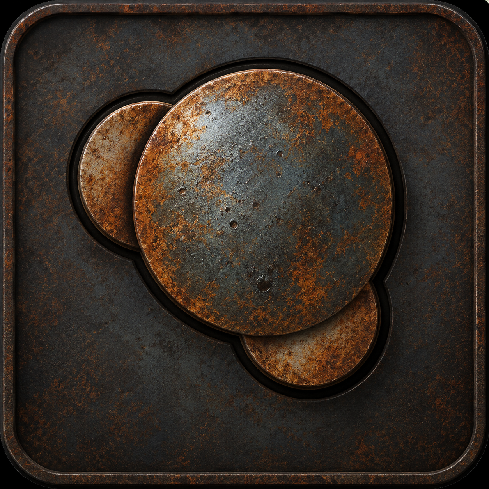

<p align="center">
  
</p>

# CueMol3

Molecular graphics for the desktop, browser and command line, built in Rust.
CueMol3 combines CueMol2-compatible scenes and scripting with a shared wgpu
viewport, molecular dynamics playback and image rendering.

[Installation](#installation) · [Quick start](#quick-start) ·
[User guide](docs/usage.md) · [Development](docs/development.md) ·
[Validation](docs/validation.md)

## Features

| Work with | Capabilities |
| --- | --- |
| Molecular structures | Ribbons, cartoons, ball-and-stick models, selections, labels, measurements and editable coloring |
| Maps and surfaces | Crystallographic and EM density, electrostatic potentials, isosurfaces, volume rendering and molecular surfaces |
| MD trajectories | Indexed DCD, XTC, TRR, AMBER NetCDF and MDCRD playback with shared trajectory sources |
| Images and scenes | Built-in GI and NPR rendering, stereo views, animation export, embedded QSC scenes and mesh export |
| Automation | JavaScript, a shared command API, MCP and an optional AI Agent |

The native and browser interfaces share Tritium's layout, light and dark themes,
and common application and command logic. Release packages bundle APBS,
PDB2PQR, FFmpeg, POV-Ray and the native OIDN runtime.

## Installation

The installers below require a published
[GitHub release](https://github.com/mogura-rs/cuemol2-rs/releases). To use an
unreleased revision, [build from source](#build-from-source).

### Linux and macOS

```sh
curl -LsSf https://raw.githubusercontent.com/mogura-rs/cuemol2-rs/main/install.sh | sh
```

The installer verifies `SHA256SUMS` and installs the application and bundled tools
in `~/.local/bin`. Add that directory to `PATH` if needed. Set
`CUEMOL_INSTALL_DIR` to choose another directory or `CUEMOL_VERSION=vX.Y.Z`
to select a release. macOS releases also provide unsigned application bundles.

### Windows

```powershell
irm https://raw.githubusercontent.com/mogura-rs/cuemol2-rs/main/install.ps1 | iex
```

The default destination is `%LOCALAPPDATA%/CueMol/bin`.

### Updates

```sh
cuemol self-upgrade --check
cuemol self-upgrade
```

The native application also provides **Help > Check for updates**.

## Quick start

### Open a structure

```sh
cuemol example.pdb
```

Run `cuemol` without arguments to open the native application. You can also use
the file dialog or drag and drop. Proteins start as ribbons, nucleic acids as
cartoons, and other atoms as ball-and-stick models.

| Default control | Action |
| --- | --- |
| Left drag | Rotate |
| Right drag | Pan |
| Wheel | Zoom |
| Click an atom | Toggle its label |
| Double-click an atom | Toggle its residue selection |
| `C` / `F` / `Home` | Center selection / fit selection / fit scene |

See the [user guide](docs/usage.md#mouse-and-keyboard) for selection tools,
measurements, alternate mouse presets and stereo controls.

### Use the browser

```sh
cuemol web serve
```

Release binaries embed the browser application. WebGPU requires HTTPS or
localhost; append `?renderer=webgl` to use the WebGL2 fallback. Local files stay
in the browser unless shared through the optional AI Agent. See
[browser usage and limits](docs/usage.md#browser) for trajectories, exports and
native tool differences.

### Render, script and automate

```sh
cuemol render example.pdb image.png --width 1200 --height 900
cuemol render example.qsc illustration.png --style npr
cuemol export-scene example.pdb model.obj
cuemol trajectory-info trajectory.xtc
cuemol run commands.js
cuemol -c 'print(21 * 2);'
cuemol mcp config
```

JavaScript uses the embedded Boa engine. `cuemol mcp connect` connects a client
to the running native GUI; `cuemol mcp serve` owns an independent headless scene.
Use `cuemol mcp tools` to inspect the installed command schemas. See
[commands and configuration](docs/usage.md#commands-mcp-and-configuration) or
the [AI Agent guide](docs/usage.md#ai-agent) for further setup.

## Build from source

Use a Rust toolchain, a C++20 compiler and the platform's native GUI dependencies.
From the repository root:

```sh
cargo build --locked -p cuemol-cli --features gui
cargo run --locked -p cuemol-cli --features gui -- example.pdb
```

To include the browser application, also install `uv`, then run:

```sh
cargo run --locked -p cuemol-cli -- web build
cargo build --locked --release -p cuemol-cli --features gui,bundled-web
```

The default build without `gui` stays headless. The sibling `../cuemol2`
checkout is an optional, read-only compatibility reference. The
[development guide](docs/development.md) covers native dependencies, bundled
tools, tests, release packaging and Pages deployment.

## Documentation and compatibility

| Document | Contents |
| --- | --- |
| [User guide](docs/usage.md) | Viewing, maps, trajectories, rendering, scripting, MCP, preferences and AI Agent |
| [Development](docs/development.md) | Builds, tests, compatibility fixtures, releases and deployment |
| [Validation](docs/validation.md) | Executed checks, benchmarks, reference comparisons and known differences |
| [Architecture](CLAUDE.md) | Crate boundaries and implementation conventions |

Command coverage does not imply pixel-identical rendering or equivalence for
every parameter combination. Browser filesystem and process access differ from
native execution, and hardware quad-buffer stereo is unavailable. Read the
[compatibility boundaries](docs/usage.md#compatibility-boundaries) when comparing
reference scenes. Local validation does not publish a release or a Pages site.
